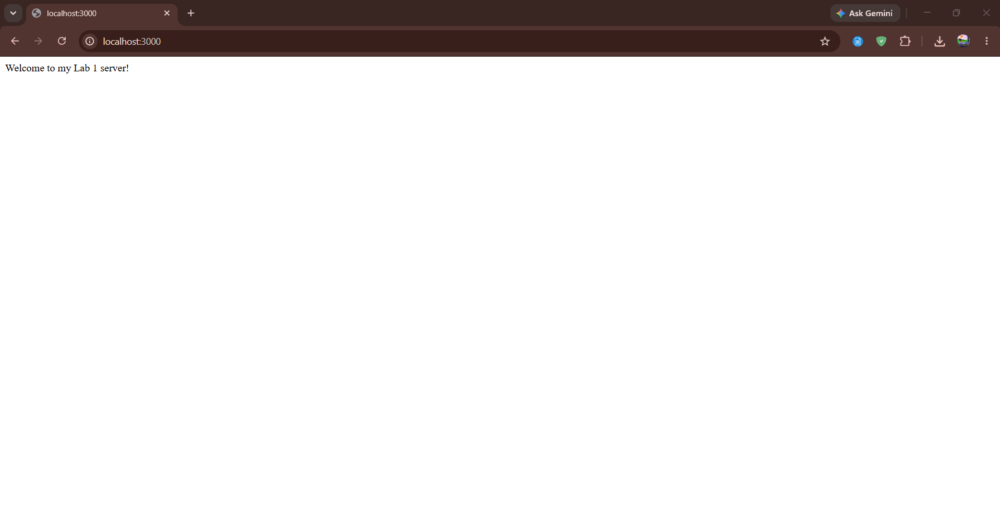
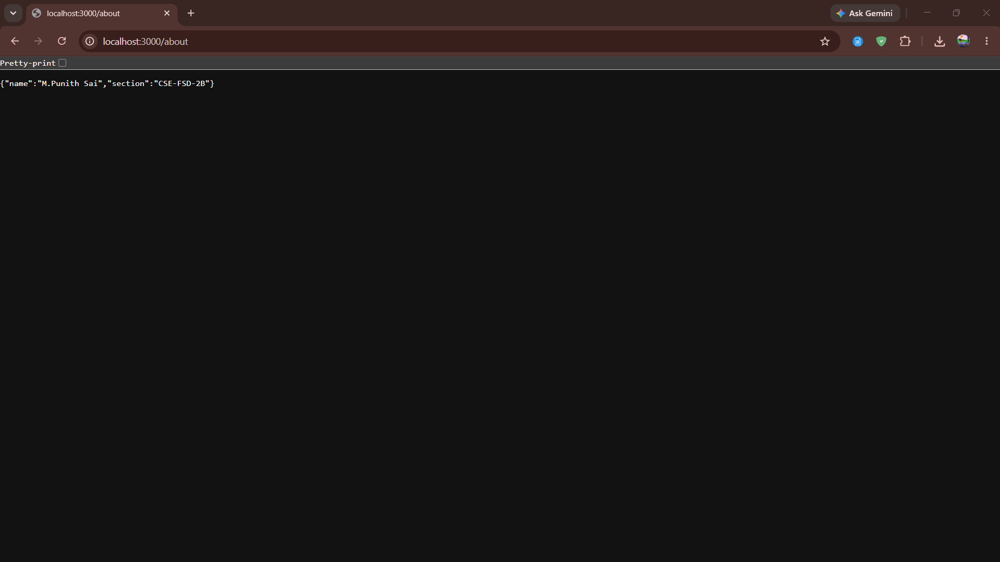
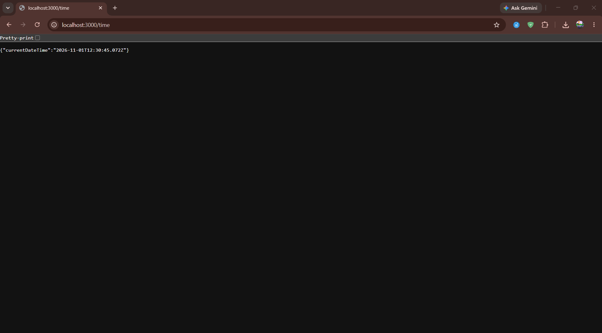
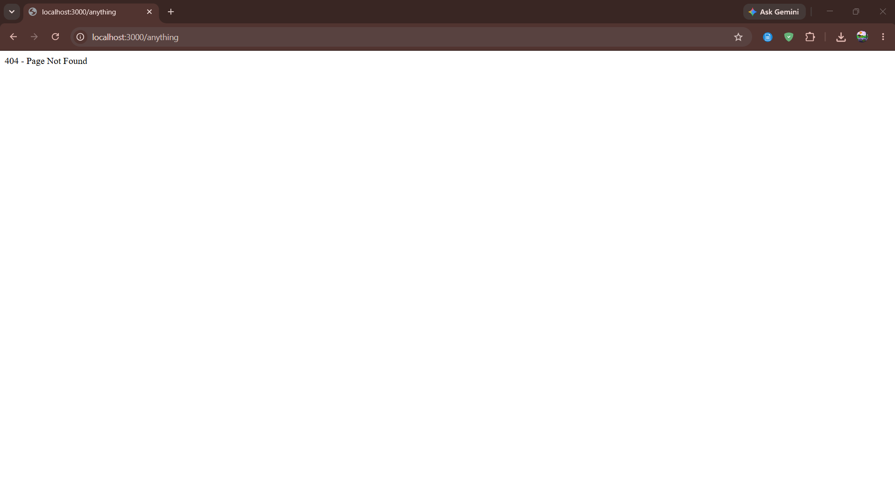

# Lab 1: Node.js and Express Server

## Student Details

- **Name:** M.Punith Sai
- **Registration Number:** 252U1R7064
- **Section:** CSE-FSD-2B
- **Course:** Backend Development Fundamentals
- **Lab Number:** 01

## Live Link

- **Deployment Status:** Local development completed and tested. Cloud deployment is pending/optional.
- **Deployment Note:** To deploy to platforms such as Vercel or Render, connect the GitHub repository, set the build command to `npm install`, and specify the start command as `node server.js`. The server dynamically uses `process.env.PORT` with a default of `3000`.

## Objective

To set up a Node.js project, understand `package.json` configurations, create a basic HTTP server using Node.js's built-in `http` module, and build an Express server with multiple functional routes returning appropriate HTTP status codes and responses.

## Technologies Used

- **Node.js** (v20.18.0) - Server-side JavaScript runtime
- **Express.js** (v5.3.0) - Minimal and flexible web application framework
- **JavaScript** (CommonJS syntax)
- **npm** (v10.8.2) - Node package manager
- **Visual Studio Code** - Code editor

## Project Structure

```text
lab-01/
├── screenshots/
│   ├── home.png
│   ├── about.png
│   ├── time.png
│   └── not-found.png
├── server-http.js
├── server.js
├── package.json
├── package-lock.json
├── .gitignore
└── README.md
```

## Explanation of `package.json` Fields

- **`name`**: The unique name of the project or package (e.g., `"lab-01"`).
- **`version`**: The current semantic version of the application (e.g., `"1.0.0"`).
- **`description`**: A brief explanation of the project's purpose.
- **`main`**: The primary entry point file of the application (e.g., `"server.js"`).
- **`type`**: Module system in use; `"commonjs"` allows standard `require()` and `module.exports` syntax.
- **`scripts`**: Command-line shortcuts executable via `npm run <script>`, such as `"start": "node server.js"`.
- **`dependencies`**: Lists third-party packages installed via npm that are required for production runtime (e.g., `"express": "^5.3.0"`).
- **`author`**: Name of the developer/student maintaining the project.
- **`license`**: Specifies the open-source or proprietary license (e.g., `"ISC"`).

## Installation and Setup

### Prerequisites

- Node.js (v18+ recommended) and npm installed.
- Terminal or command prompt.

### Steps to Run

1. Clone or download the repository to your local machine:
   ```bash
   git clone <repository-url>
   ```
2. Navigate into the lab directory:
   ```bash
   cd lab-01
   ```
3. Install project dependencies:
   ```bash
   npm install
   ```
4. Start the Express server:
   ```bash
   node server.js
   ```
   *(or run `npm start`)*
5. Open your web browser or API client (Postman/curl) and visit:
   ```text
   http://localhost:3000
   ```

### How to Run the Basic HTTP Server

To test the server built using Node.js's native `http` module:

1. Stop any currently running server using `Ctrl + C`.
2. Start the native HTTP server:
   ```bash
   node server-http.js
   ```
   *(or run `npm run start:http`)*
3. Visit `http://localhost:3000` in your browser. The response should display plain text: `Hello`.
4. Stop the server using `Ctrl + C` before running the Express server again to avoid port conflicts.

## Endpoints

| Method | Endpoint | Description | Expected Status |
|---|---|---|---|
| GET | `/` | Returns a welcome message | 200 OK |
| GET | `/about` | Returns student name and section in JSON format | 200 OK |
| GET | `/time` | Returns the current date and time in JSON format | 200 OK |
| GET | `/anything` | Demonstrates the response for an unknown route | 404 Not Found |

> **Note:** `/anything` is used as an illustrative example. Any undefined path requested on the server returns HTTP 404 with the message `404 - Page Not Found`.

## Screenshots

### 1. Home Route (`/`)
Displays the welcome message with HTTP 200 OK status.



### 2. About Route (`/about`)
Returns the student's name and section in JSON format with HTTP 200 OK status.



### 3. Time Route (`/time`)
Generates and returns the current date and time in JSON format with HTTP 200 OK status.



### 4. Unknown Route (`/anything`)
Demonstrates handling an undefined route, returning an explicit HTTP 404 Not Found status code and message.



## HTTP Status Codes

- **`200 OK`**: Standard response for successful HTTP requests. Returned for `/`, `/about`, and `/time`.
- **`404 Not Found`**: The requested resource or endpoint could not be found on the server. Returned for all undefined routes.

## Viva Questions and Answers

### 1. What is the difference between `package.json` and `node_modules`?
- **`package.json`** is a lightweight manifest file that lists project metadata, custom scripts, and direct dependency declarations (along with their version rules). It is meant to be version-controlled in Git.
- **`node_modules`** is the physical directory on disk containing the actual installed JavaScript code for all declared dependencies and their sub-dependencies. It is large and should always be excluded from Git using `.gitignore`.

### 2. What does `app.listen()` do?
`app.listen()` binds and listens for connections on the specified host and port (e.g., port 3000). It converts the configured Express application into an active HTTP server ready to accept incoming client network requests.

### 3. What do `request` and `response` represent?
- **`request` (`req`)**: An object containing data about the incoming HTTP request from the client, including HTTP headers, URL parameters, query strings, and body payload.
- **`response` (`res`)**: An object providing helper methods allowing the server to construct and send back the HTTP response, such as `.status()`, `.send()`, and `.json()`.

## Problems Faced and Solutions

1. **Port Already in Use (`EADDRINUSE`)**:
   - *Problem:* Running both `server-http.js` and `server.js` simultaneously caused a conflict because both listen on port 3000 by default.
   - *Solution:* Ensured the native HTTP server is stopped (`Ctrl + C`) before starting the Express server, and added support for `process.env.PORT || 3000` to allow dynamic port binding.

2. **Ensuring Actual 404 Status Code for Undefined Routes**:
   - *Problem:* Sending a custom string message might default to HTTP 200 status unless explicitly configured.
   - *Solution:* Used Express catch-all middleware with `response.status(404).send("404 - Page Not Found")` to ensure both the HTTP status code (404) and response text indicate the route was not found.

## Git and Repository Notes

- The `.gitignore` file excludes `node_modules/` and `.env` to prevent committing dependencies or environment variables.
- Verified that `node_modules/` is not tracked.
- Relative paths are used for screenshot references (`screenshots/*.png`).
- Code style strictly follows standard beginner-friendly CommonJS conventions.
