# Lab 3: REST API, query parameters, validation, debugging

**Name:** YOUR NAME HERE · **Registration number:** YOUR REG NO · **Section:** YOUR SECTION

**Live link:** https://YOUR-DEPLOYED-URL-HERE  
<!-- If you cannot deploy, replace the line above with: "Not deployed: <reason>. Postman screenshots of every endpoint are included below." -->

## How to run

Requirements: Node.js 18 or later.

```bash
cd lab-03
npm install
cp .env.example .env     # then edit values if needed (never commit .env)
npm run seed             # optional: adds 8 sample books
npm start                # starts the server
npm test                 # optional: runs 28 automated checks
```

Environment variables (`.env`, see `.env.example`):

| Variable | Meaning | Example |
|----------|---------|---------|
| PORT | Port the server listens on | 3000 |
| DB_PATH | SQLite database file path | ./books.db |

## Endpoints

Resource names are nouns; the HTTP method shows the action.

| Method | Path | Description | Success |
|--------|------|-------------|---------|
| GET | /books | List books with search, sort, price filter and pagination | 200 |
| GET | /books/:id | Get one book by id | 200 |
| POST | /books | Create a book (title, author, price required) | 201 |
| PUT | /books/:id | Update a book | 200 |
| DELETE | /books/:id | Delete a book | 200 |

### Query parameters for GET /books

| Parameter | Default | Description |
|-----------|---------|-------------|
| search_q | (none) | Partial title match using `LIKE` |
| order_by | id | One of `id`, `title`, `author`, `price` |
| order | ASC | `ASC` or `DESC` |
| limit | 10 | Rows per page (max 100) |
| offset | 0 | Rows to skip |
| min_price | (none) | Minimum price |
| max_price | (none) | Maximum price (both given -> `BETWEEN`) |

Example: `GET /books?search_q=code&min_price=100&max_price=1000&order_by=price&order=DESC&limit=5&offset=0`

### Status codes and response format

| Situation | Status | Body |
|-----------|--------|------|
| Fetched / updated / deleted | 200 | `{ "message": "...", "data": ... }` |
| Created | 201 | `{ "message": "Book created successfully", "data": {...} }` |
| Missing title/author, non-numeric price, bad query value, bad id, malformed JSON | 400 | `{ "message": "..." }` |
| Id or route does not exist | 404 | `{ "message": "Book not found" }` |
| Unexpected server error | 500 | `{ "message": "Internal server error" }` |

All SQL uses parameterised queries. `order_by` is checked against a whitelist because column names cannot be bound as parameters.

## Screenshots

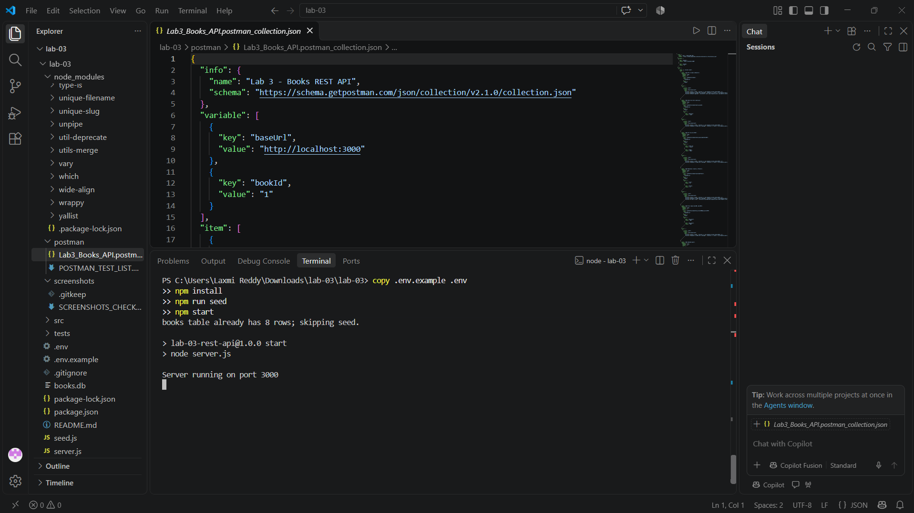
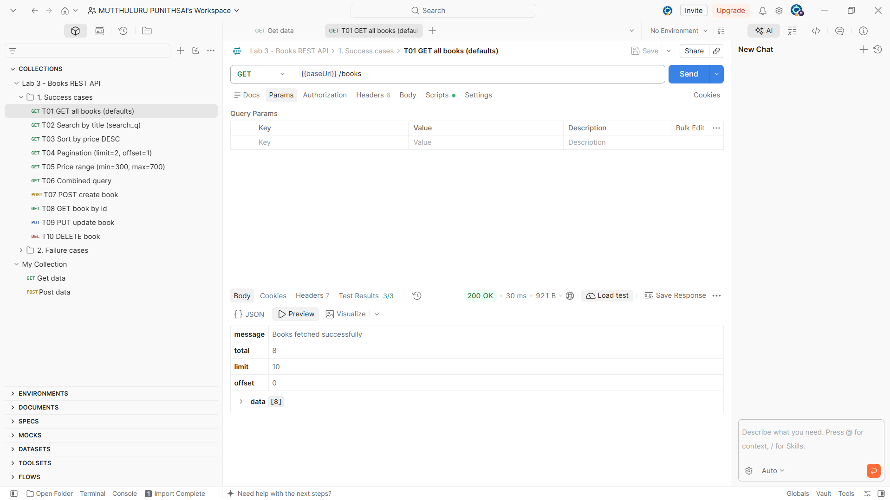
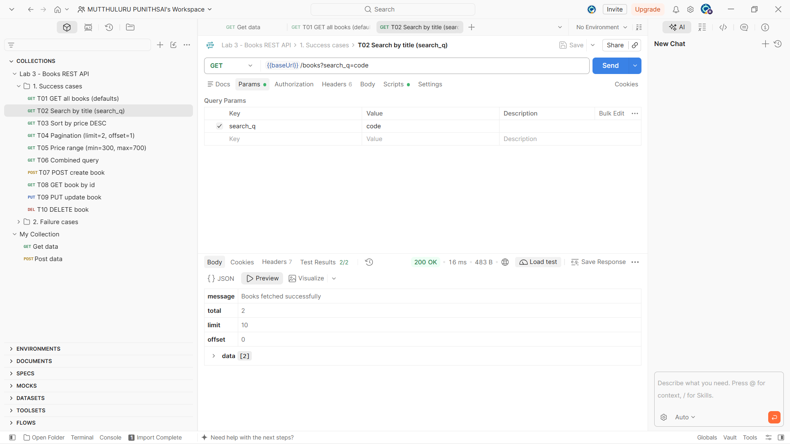
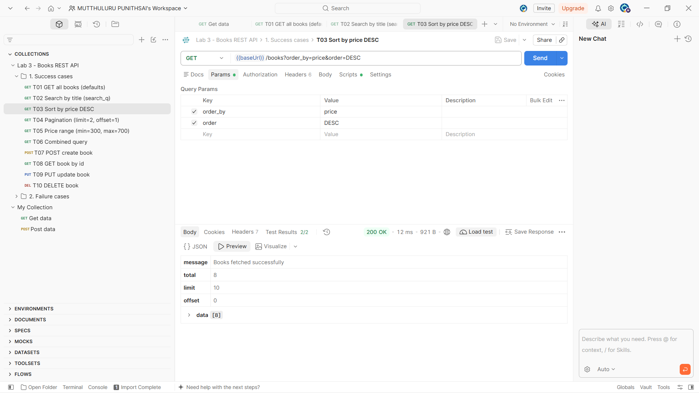

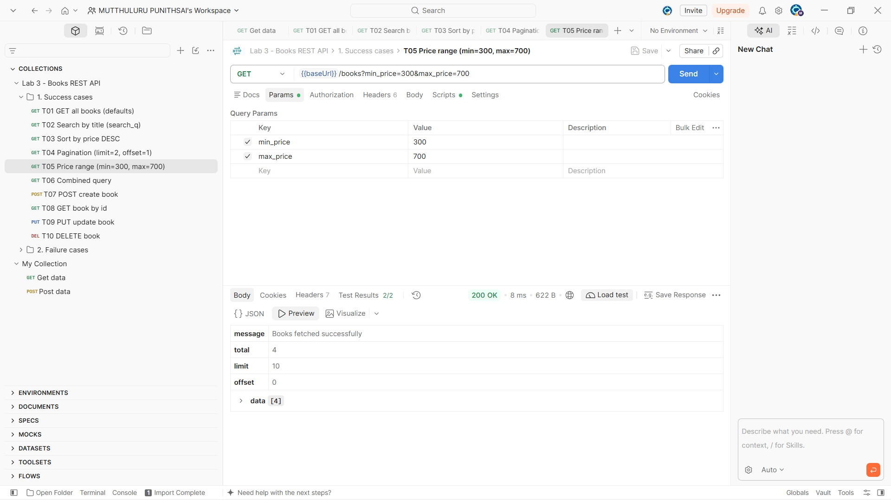

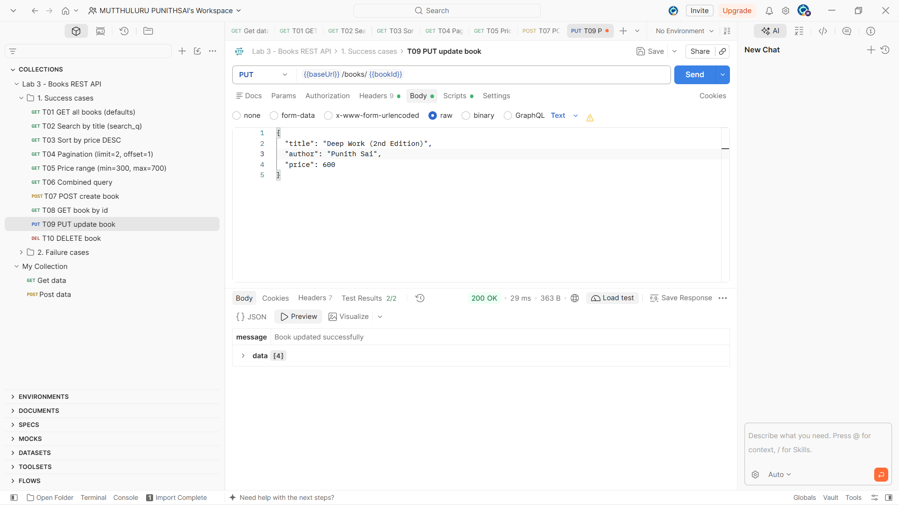
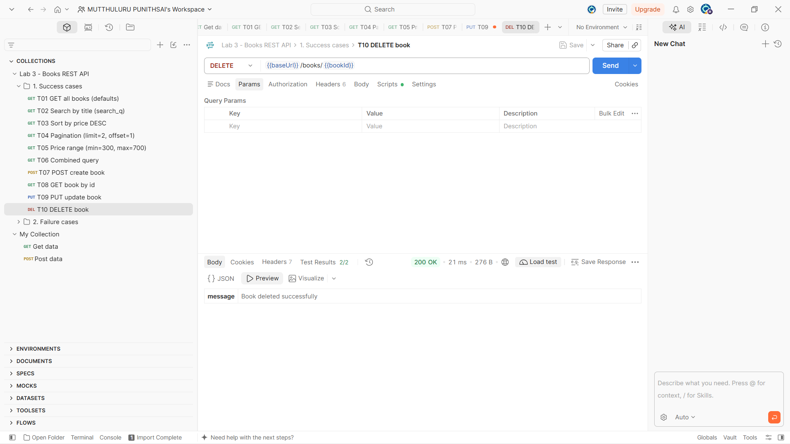
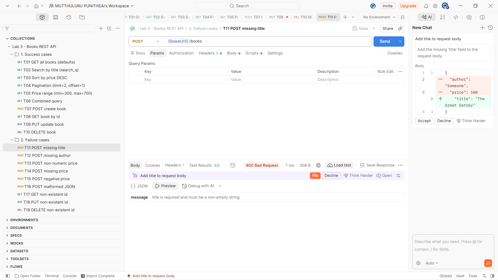
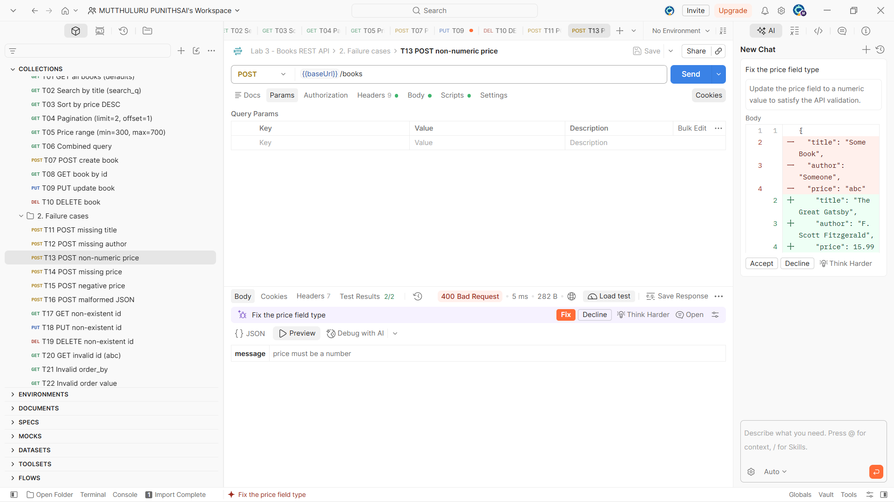
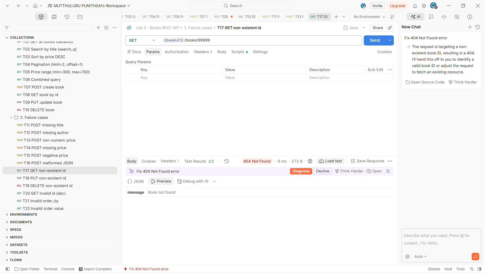
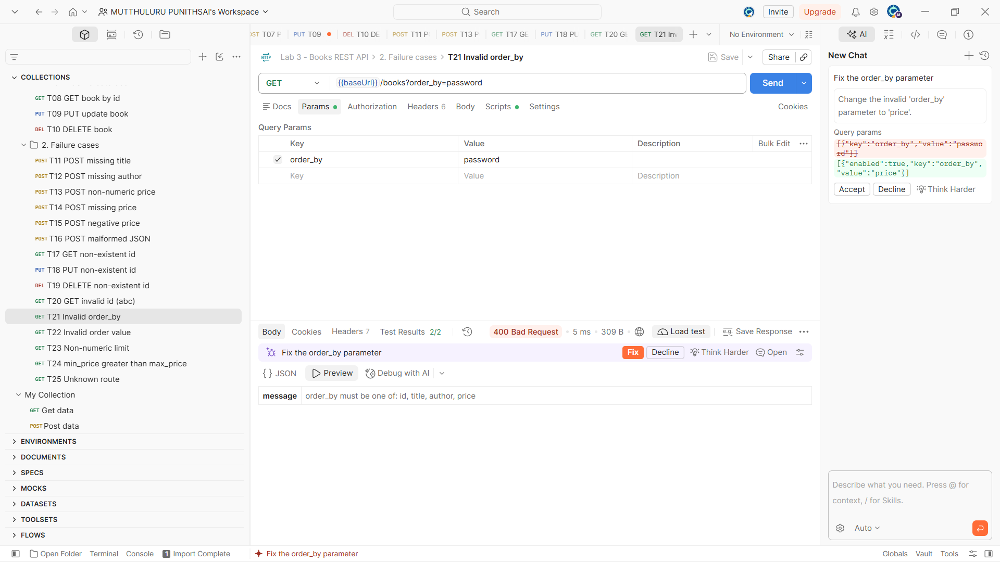
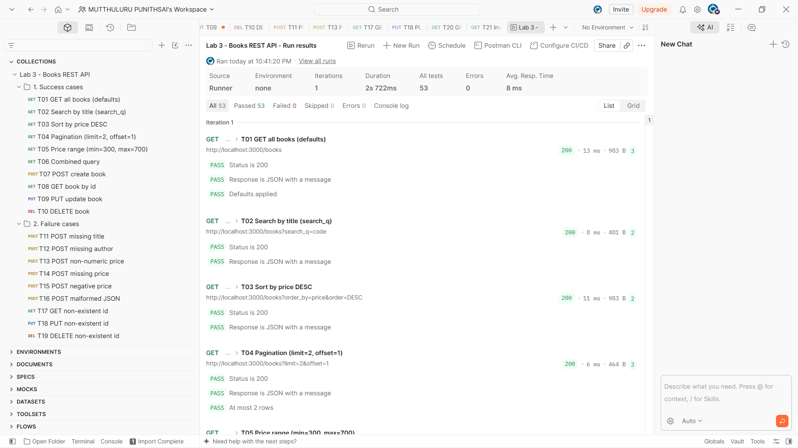

## Postman tests

Collection: [`postman/Lab3_Books_API.postman_collection.json`](postman/Lab3_Books_API.postman_collection.json) (25 requests, 10 success and 15 failure cases). Full list: [`postman/POSTMAN_TEST_LIST.md`](postman/POSTMAN_TEST_LIST.md).

## Notes: problems faced and how I solved them

Debugging exercise (details in [`debugging/DEBUGGING_NOTES.md`](debugging/DEBUGGING_NOTES.md)):

1. **EADDRINUSE**: the port was already in use. Stopped the other process / changed `PORT`, and added a friendly error handler.
2. **Wrong import path**: `Cannot find module './validators'`. Corrected the relative path.
3. **Table-name typo**: `no such table: book`. Changed to `books`.
4. **Missing await**: `db.run()` returned a Promise so `lastID` was undefined. Added `await`.

Other decisions:
- Used `Number()` plus `Number.isFinite()` to reject non-numeric prices such as `"abc"`.
- Added a central error handler so malformed JSON returns 400 and every error uses `{ "message": "..." }`.
- Used a whitelist for `order_by` to prevent SQL injection through column names.
- ADD YOUR OWN NOTES HERE (anything you personally struggled with).


